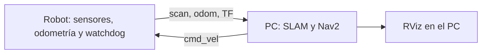

# Operación: simulación y robot real

## Simulación desde un clon

Seguir primero [README.md](README.md) para construir la imagen y ejecutar `compilar.sh`. La carpeta `carpeta_compartida` se monta en `/home/helio/carpeta_compartida` del contenedor.

Dentro del contenedor:

```bash
cd ~/carpeta_compartida/husarion_ws
./simulacion.sh
```

El script ejecuta los cuatro comandos de [comandos.txt](comandos.txt): Gazebo con GUI/cámara, Nav2 con su perfil sim, SLAM Toolbox síncrono y RViz con `config/rviz_config.rviz`. Usa tiempo simulado y conserva el entorno ROS de la terminal. Compose configura por defecto dominio 20, Fast DDS y `ROS_LOCALHOST_ONLY=1` para esta simulación local. Se pueden cambiar estos valores mediante `.env`.

Ctrl+C cierra los procesos del script; si alguno se bloquea, escala a SIGTERM y SIGKILL. No ejecutar a la vez los cuatro comandos manuales y el script, ni el antiguo lanzamiento integrado `experimento.launch.py`.

SLAM publica `/map`; el mapa crece conforme el robot observa nuevas zonas. La resolución del perfil sim es 5 cm. RViz muestra `/map`, no el costmap global como sustituto del mapa de SLAM. Si se cambia la configuración con RViz ya abierto, cargarla de nuevo con **File → Open Config**.

## Distribuir el experimento real



Se necesita una compilación propia en cada arquitectura. En cada workspace Foxy:

```bash
./compilar.sh --hardware
```

Esta opción compila base/bringup, láser y cámara. El driver Astra descarga el SDK OpenNI2 fijado en CMake; no reutilizar binarios de otro ordenador. El PC de navegación puede usar la imagen Docker; el robot necesita acceso a sus puertos seriales/USB y permisos adecuados. El Compose base de simulación no expone dispositivos físicos.

En ambos equipos, antes de arrancar nodos:

```bash
export ROS_DOMAIN_ID=20
export RMW_IMPLEMENTATION=rmw_fastrtps_cpp
export ROS_LOCALHOST_ONLY=0
```

Los scripts reales habilitan comunicación fuera de localhost. Ambos equipos deben tener conectividad DDS/UDP, preferiblemente Ethernet para la primera prueba, y relojes sincronizados con NTP/chrony. Todos sus nodos usan `use_sim_time=false`; Gazebo no debe participar en ese dominio durante el experimento físico.

En el robot:

```bash
./real_onboard.sh serial_port:=/dev/ttyS4 lidar_port:=/dev/ttyUSB0
```

Arranca base, láser, cámara, adaptación de pose a odometría y watchdog de 0,5 s. Los puertos, baudios y TF físicos son valores iniciales que deben verificarse. Si no se necesita cámara: `./real_onboard.sh start_camera:=false`.

En el PC:

```bash
./real_offboard.sh
# O con parámetros físicos calibrados:
./real_offboard.sh nav_params:=/ruta/absoluta/nav2_calibrado.yaml
```

Este modo usa SLAM asíncrono y Nav2 sobre los drivers existentes; no arranca Gazebo ni otro driver. Mantener una única fuente de `odom → base_link` y otra de `map → odom`. No ejecutar simultáneamente AMCL, otro SLAM ni dos bringups.

La adaptación física exige poses válidas en `odom` con marcas de tiempo crecientes; no implementa fusión de IMU ni calibra covarianzas. El watchdog se ejecuta localmente en el robot, usa tiempo monótono y entrega ceros al puente cuando caducan los comandos. No cubre caída del sistema, bloqueo del puente ni fallo del propio watchdog: se necesita timeout en firmware y parada física comprobada.

El driver Astra actual publica imagen y profundidad, pero no completa CameraInfo RGB ni `/camera/points`. Las vistas Camera/nube de la configuración guardada necesitan esos datos en hardware; no deben sustituirse intrínsecos RGB por calibración de profundidad.

## Comprobar el pipeline

Con el mismo entorno ROS que los procesos:

```bash
ros2 topic hz /scan
ros2 topic hz /odom
ros2 topic info /map --verbose
ros2 param get /slam_toolbox use_sim_time
ros2 lifecycle get /controller_server
ros2 lifecycle get /planner_server
ros2 lifecycle get /recoveries_server
ros2 lifecycle get /bt_navigator
ros2 lifecycle get /waypoint_follower
ros2 run tf2_ros tf2_echo map base_link
```

Los comandos de frecuencia y `tf2_echo` son continuos; terminar cada uno con Ctrl+C. Antes de enviar objetivos, Nav2 debe estar activo y los datos/TF deben ser recientes. No aumentar tolerancias para ocultar retrasos.

Guardar el mapa en un directorio local excluido de Git:

```bash
mkdir -p ~/carpeta_compartida/mapas
ros2 run nav2_map_server map_saver_cli -f ~/carpeta_compartida/mapas/rosbot
```

Esto guarda mapa rasterizado e YAML, no el grafo completo de SLAM. El lanzamiento offboard actual construye mapas; no incorpora AMCL ni recuperación automática de un pose graph.

## GPU Intel/AMD opcional

La base utiliza renderizado por software. Para usar una GPU, desde la raíz del clon en el host, elegir el dispositivo y su GID reales:

```bash
export HOST_RENDER_DEVICE=/dev/dri/renderD128
export HOST_RENDER_GID="$(stat -c %g "$HOST_RENDER_DEVICE")"
# Sólo para la Intel ADL probada con Iris:
export MESA_LOADER_DRIVER_OVERRIDE=iris
HOST_UID=$(id -u) HOST_GID=$(id -g) docker compose -f compose.yaml -f compose.gpu.yaml up -d --build
docker exec ubuntu20_foxy glxinfo -B
```

El dispositivo `/dev/dri/renderD128` e Iris funcionaron en la Intel ADL probada; no son valores universales. En AMD elegir el driver verificado sin forzar Iris. El overlay no configura NVIDIA. Si `glxinfo -B` muestra `llvmpipe`, continúa el renderizado por software. Recrear el contenedor puede perder los datos que sólo estén en su capa interna: guardarlos antes en la carpeta compartida.

## Límites conocidos y pruebas

Se ha comprobado arranque de Gazebo, SLAM y Nav2 y navegación con objetivos cortos en este entorno. También se han reproducido bloqueos de Nav2 al reiniciar, errores GLSL con RViz y salidas anómalas al cerrar nodos de Foxy. Cyclone con capacidad de 50 participantes ha superado reinicios, pero conserva errores de cierre; no se presenta como solución definitiva ni se cambia automáticamente el RMW.

La prueba de integración de `tests/verify_sim_pipeline.py` comprueba el modo asíncrono offboard en un dominio y puerto Gazebo separados. Ejecutarla dentro del contenedor después de compilar, copiando el script desde el host a `/tmp` si es necesario. Sus resultados separan operación funcional y cierre limpio; no valida hardware ni red entre dos equipos. Los informes temporales y las compilaciones no forman parte del repositorio.

El uso físico requiere validar calibración, odometría, límites de velocidad, frenado y pérdida de enlace en el robot real. Clonar el repositorio no elimina esas comprobaciones.
